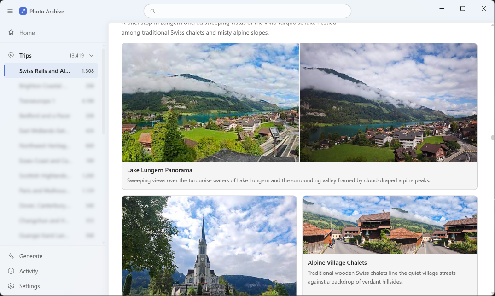
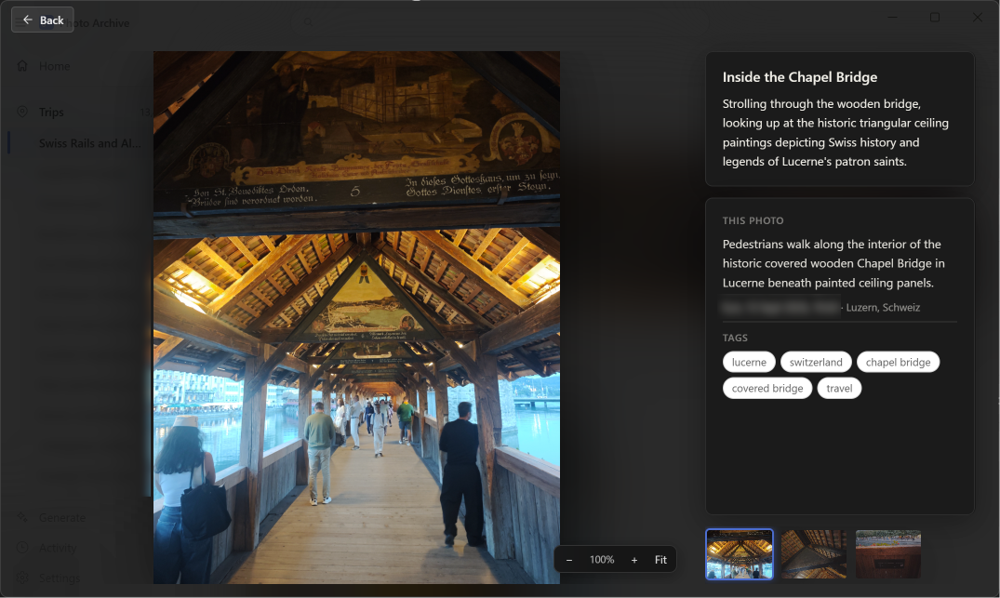

# Photo archive

A personal OneDrive photo library, indexed into a month-by-month album — and,
separately and only when you ask, described by an AI provider that captions the
photos and writes the days up.

No server is needed to read it: the web app talks to Microsoft Graph directly and
renders from sharded JSON. A small local **job server**, started by the desktop
shell, does the parts that need a machine — indexing, captioning, summarizing —
and is the only thing that ever writes to the archive.





## Get it

[The latest release](https://github.com/smallg0at/travel-archive/releases/latest) carries a
Windows installer, `Photo Archive Setup <version>.exe`. Run it and start **Photo
Archive** from the Start menu. The first run walks through the Microsoft sign-in
and asks for the two folders the archive keeps — the photos, and the metadata it
writes.

**The installer is unsigned**, so Windows says "Windows protected your PC":
*More info* → *Run anyway*. There is no code-signing certificate behind this
release; the binary is built from this source, and building it yourself (below)
is the alternative.

Describing photos with an AI provider is a separate, opt-in step: set the
provider key under **Settings → Generation**.

## From source

```
npm install
npm run --workspace pipeline build
npm run --workspace app build
npm run desktop          # Electron shell: serves the app, starts the job server
```

Without the shell: `npm run preview --workspace app -- --port 4173`, and
`node pipeline/dist/serve.js` from `pipeline/`.

`npm run package` builds the Windows installer into `desktop/release/`.

Reading needs a Microsoft sign-in and an Azure app registration — see
[One-time setup](#one-time-setup). Captioning additionally needs an AI provider
key.

## Structure

- `shared/` — TypeScript types shared between the pipeline and the app (`ArchiveIndexFile`, `PhotoShard`, `PhotoRecord`, `DayRecord`, `TripRecord`).
- `pipeline/` — three commands, in increasing order of cost (see below):
  - `scan.ts` — indexes OneDrive into per-month shards. Graph listing calls only.
  - `analyze.ts` — the AI pass: captions/tags/OCR for photos scan indexed but never looked at.
  - `organize.ts` — groups analyzed photos into day pages with summaries and layouts.
- `app/` — the web app. Reads `index.json` and month shards from OneDrive at runtime and renders the album. `app/src/mobile/` is the phone app built from the same data layer, packaged for Android with Capacitor (`app/android/`) — see [`docs/clients.md`](docs/clients.md).
- `desktop/` — the Electron shell, which serves the built app and runs the job server as a child process.

More detail:

| document | what |
|---|---|
| [`docs/pipeline.md`](docs/pipeline.md) | the storage layout, the three passes, providers, trips |
| [`docs/clients.md`](docs/clients.md) | the web app, the phone app, the desktop shell, authentication |
| [`docs/architecture.md`](docs/architecture.md) | the phone's offline archive, the offline gazetteer, how captioning works |
| [`docs/design-brief.md`](docs/design-brief.md) | what the product is — the page, the card, the map |
| [`HANDOFF.md`](HANDOFF.md) | the front door for whoever picks this up next |
| [`docs/invariants.md`](docs/invariants.md) | the rules this codebase punishes you for forgetting |
| [`docs/working-style.md`](docs/working-style.md) | how to work on it: measurement discipline, the writing's register |
| [`docs/history.md`](docs/history.md) | past regressions, and the local-model measurements |
| [`AGENTS.md`](AGENTS.md) | how an agent should work in this repo |
| [`TODO.md`](TODO.md) | where the open items live |

## One-time setup

1. **Azure app registration**: portal.azure.com → App registrations → New registration, "Personal Microsoft accounts only". Under Authentication add **both** platforms described in [`docs/clients.md`](docs/clients.md) → "Authentication", set "Allow public client flows" to **Yes** under Advanced settings, and copy the Application (client) ID.
2. `cp pipeline/.env.example pipeline/.env` — fill in `AZURE_CLIENT_ID`, `ONEDRIVE_PHOTOS_FOLDER` (the folder holding the date subfolders, `yyyy-mm/` or `yyyy/mm/`), `ONEDRIVE_METADATA_FOLDER`, `GEOCODE_CONTACT_EMAIL`, and the Gemini section.
3. `cp app/.env.example app/.env` — same client ID as `VITE_AZURE_CLIENT_ID`, and `VITE_ONEDRIVE_METADATA_FOLDER` matching `ONEDRIVE_METADATA_FOLDER`.
4. `npm install` at the repo root (installs all three workspaces).

**On a packaged install there is no step 2.** The installer bakes every
non-secret setting (see the allowlist in `desktop/scripts/bundle-pipeline.mjs`),
so the only thing missing is the AI provider's API key — set it under
**Settings > Generation**, which writes `.env` beside the archive and applies it
to the running server without a restart. Keys are write-only across that
boundary: the server reports whether one is set and never returns it.

One caveat worth knowing, because it is silent: `process.env` beats `.env`, so
if the key is also set as a **system environment variable**, a key saved in the
form works until the next restart and then loses to the machine's setting.
Settings says so when it detects one.

## Known simplifications

- **The desktop holds shards in memory for the session, not persisted client-side.** Flipping between month tabs is instant after first load, but a reload re-fetches. The phone does persist them (see [`docs/clients.md`](docs/clients.md)); on the desktop the job server's mirror is a ~34ms read, so there is less to gain.
- **No cross-archive search.** Finding "everything tagged `temple` in 2023" means loading every shard. The fix when it's wanted is a third artifact — a compact `search.json` of `{id, tags, place, truncated text}`, ~1.5MB at 10k photos — not turning the store into a database.
- **Model is configurable via `GEMINI_MODEL`** (default `gemini-3.6-flash`). For bulk tagging at this volume a cheaper tier (`gemini-3.6-flash-lite`) is worth considering.
- **Trip ranges are edited by hand** (`pipeline/trips.json`); re-run `organize` after adding one.

## Licence and attribution

**AGPL-3.0-or-later** — see [`LICENSE`](LICENSE), and [`COPYING`](COPYING) for the
GNU General Public License it builds on.

The network clause is the reason for this licence rather than the GPL or the
LGPL: this is not a library but an application, with a job server and a remote
reader, and neither of those says anything about use over a network. AGPL-3
section 13 closes that — a fork that is hosted rather than shipped owes its users
the source. Every dependency is compatible; the inventory is in
[`THIRD-PARTY-NOTICES.md`](THIRD-PARTY-NOTICES.md), generated from the lockfile by
`scripts/third-party-notices.mjs`.

Distributing a built installer carries two obligations the repository itself does
not: ship the licence texts of everything bundled, and leave the bundled LGPL
parts replaceable (LGPL-3 section 4).

The code also depends on third-party data whose licences require attribution:

- **GeoNames** — settlement names and coordinates, **CC BY 4.0**. The credit
  line in the app's Settings (`ui.settings.dataCredits`) is that attribution and
  must stay; it must also stay here if the derived index is ever distributed.
- **Natural Earth** — map geometry (land, sea, borders), public domain.
- **OpenStreetMap** — only if a POI layer is ever built: **ODbL**, so the derived
  index must be built locally, kept out of the repository, and attributed in
  Settings like GeoNames.
- **Two copyleft components a build bundles**: `libheif-js` (LGPL-3.0, reached
  through `heic-decode`) and the libvips inside sharp's prebuilt packages
  (LGPL-3.0-or-later). Both sit alongside AGPL-3-licensed code without conflict,
  and both are listed with their texts in THIRD-PARTY-NOTICES.md.

Personal data is deliberately absent: `.env`, tokens, the archive itself and
anything under `private/` are gitignored. See [`docs/invariants.md`](docs/invariants.md) → "Nothing personal is committed".
